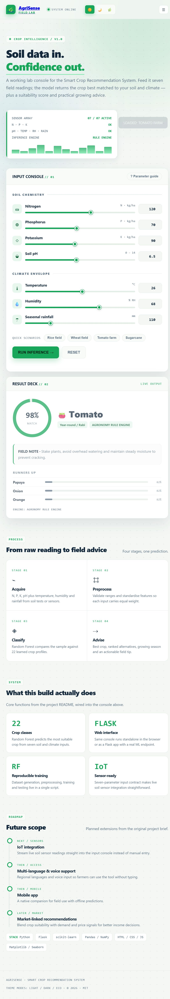

# 🌱 Smart Crop Recommendation System — Modified Website



A re-imagined **"Field Lab" console UI** for the Smart Crop Recommendation System from the original README.
The look is intentionally different from the original page — only the **functions** are kept — while the
project's green identity remains available as one of **3 colour modes**. Synthetic training data yields
**~88% held-out accuracy** with the Random Forest.

## 🎨 Three theme modes
| Mode | Description |
|------|-------------|
| ☀️ Light | Clean white / navy layout (default, matches the original project palette) |
| 🌙 Dark | Deep navy surfaces with bright green accents for low-light use |
| 🌿 Eco | Warm, earthy forest-green palette inspired by agriculture |

The choice is remembered in `localStorage`. Switch anytime with the three buttons in the navbar.

## 🚀 What's included
- **Standalone website** — open `index.html` directly in a browser; prediction works offline with the built-in agronomy engine.
- **Flask backend** — `app.py` serves the themed website and exposes `/predict`, `/api/crops` and `/health`.
- **ML training** — `test.py` generates a dataset, trains a Random Forest (with scaling) and saves the model.
- **Both engines** — Flask uses the trained model when available, otherwise it falls back to the same rule engine used offline.

## 📂 Project structure
```
smart-crop-recommendation/
├── index.html                  ← standalone website (open this first)
├── templates/index.html        ← Flask version of the same website
├── static/css/style.css        ← all 3 theme modes + responsive layout
├── static/js/crop-data.js      ← 22 crop agronomy profiles
├── static/js/app.js            ← theme switcher, form, prediction, results
├── docs/screenshot.jpeg        ← website screenshot shown above
├── app.py                      ← Flask backend
├── test.py                     ← dataset generation + model training/testing
├── crop_profiles.py            ← shared Python crop profiles
├── requirements.txt
├── data/                       ← generated dataset (after running test.py)
└── model/                      ← generated model files (after running test.py)
```

## ▶️ Run it

### Option 1 — no installation (standalone)
Double-click `index.html`, or:
```bash
python -m http.server 8000
# open http://localhost:8000
```

### Option 2 — full Flask + ML app
```bash
pip install -r requirements.txt
python test.py        # trains the Random Forest (optional but recommended)
python app.py         # open http://localhost:5000
```

## 🔌 API
`POST /predict` with JSON:
```json
{ "n": 90, "p": 45, "k": 50, "ph": 6.5, "temp": 28, "humidity": 82, "rainfall": 220 }
```
Response includes `crop`, `emoji`, `season`, `confidence`, `tip`, `model` and `alternatives`.

## 🚜 Features (from the original README)
- Predicts the best crop from soil & climate parameters
- Web-based user interface with Flask
- Dataset preprocessing & model training included
- Scalable & extendable for IoT integration

## 📜 License
MIT License.
